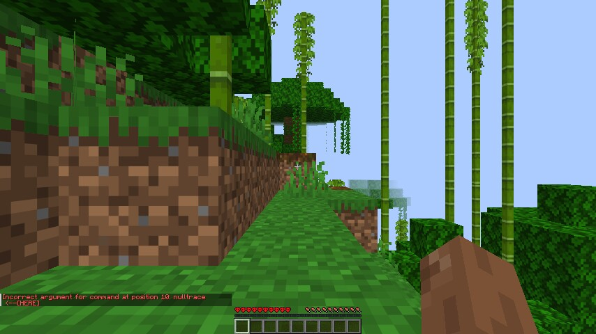
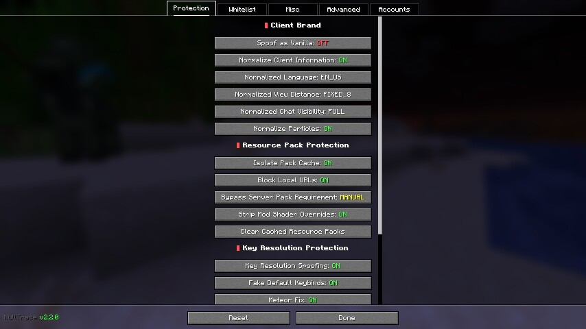

<p align="center">
  
</p>

<h1 align="center">NullTrace</h1>

<p align="center">
  Client-side Minecraft privacy and fingerprinting protection for Fabric.
</p>

<p align="center">
  <a href="https://www.curseforge.com/minecraft/mc-mods/nulltrace"></a>
  <a href="https://gitlab.com/international-duck-incorporated/NullTrace/-/releases"></a>
  <a href="LICENSE"></a>
</p>

NullTrace gives you control over information your Minecraft client exposes to servers. It reduces common mod fingerprints, limits tracking through server resource packs, and makes privacy decisions inspectable.

Full documentation — installation, every option, the command reference, the privacy model and
troubleshooting — lives in the **[wiki](https://gitlab.com/international-duck-incorporated/NullTrace/-/wikis/home)**
(sources in [`docs/wiki/`](docs/wiki), kept in sync with this repository).

NullTrace is a fork of [OpSec](https://github.com/aurickk/OpSec) by [aurickk](https://github.com/aurickk), developed independently with its own branding, protections, and multi-version builds.

> [!IMPORTANT]
> **Official downloads are available on [CurseForge](https://www.curseforge.com/minecraft/mc-mods/nulltrace) and [GitLab Releases](https://gitlab.com/international-duck-incorporated/NullTrace/-/releases).**
>
> Source code, issues, and development remain on GitLab. Treat JARs from other sites, unsolicited messages, or unofficial mirrors as untrusted.

## What NullTrace protects

| Surface | Protection |
| --- | --- |
| Client identity | Optionally report a vanilla client brand and filter mod/client-identification payloads, including ViaVersion and ViaFabricPlus identity details |
| Mod networking | Control which mods may expose custom channels and mod-injected known-pack identifiers |
| Translation and keybind probes | Prevent untrusted server components from resolving protected mod keys; optionally report default vanilla keybinds |
| Client information | Configure normalization of language, view distance, chat visibility, and particle settings |
| Resource-pack tracking | Isolate server-pack caches by account and remove username/UUID identity headers from pack requests |
| Resource-pack destinations | Block requests and redirects to local/private network addresses |
| Server-pack content | Control whether server packs are applied and strip shader overrides targeting protected mods |
| Cookies and transfers | Block server cookies and unwanted server-directed transfers |
| Chat and telemetry | Choose chat-signing behavior and block Minecraft telemetry to Mojang |
| Privacy diagnostics | Inspect connection decisions, alerts, and per-server profiles |
| Accounts | Switch stored Minecraft sessions without restarting; encrypt session and refresh tokens at rest |

### Limits and trade-offs

NullTrace **does not make you anonymous or completely undetectable**. It does not hide your IP address, account identity, gameplay behavior, or every protocol-level difference. It is a privacy tool, not an anti-cheat bypass.

Some servers and mods require custom channels, signed chat, resource packs, cookies, or transfers. Blocking those features can break functionality or prevent a connection. Allowing them restores functionality at the cost of exposing the corresponding information. Use the whitelist and per-server profiles deliberately rather than assuming one setting is right for every server.

### Compatibility notes worth knowing before you file a bug

- **Hosting a LAN world turns probe protection off for you.** Translation-probe and keybind
  protection both stand down when `hasSingleplayerServer()` is true, which is also true while you
  are the *host* of an "Open to LAN" world. There is no remote server to leak to in that case, but
  it does mean a LAN session is not representative when you are testing those protections.
- **`meteorFix` disables mixins belonging to Meteor Client.** With that option on (the default),
  NullTrace cancels a small set of another mod's mixins. It is deliberate and documented in
  `MeteorMixinCanceller`, but if you are debugging Meteor behaviour, turn it off first.
- **Jar-integrity verification is a speed bump, not a guarantee.** The check compares your jar
  against the GitLab release checksums and can be silenced with `tamperWarningDismissed`; anyone who
  can modify your jar can also remove the check. It raises the cost of a casual tamper — it does not
  prove the jar you are running is the one that was released.
- **Pack-cache isolation says so when it stops working.** The injection behind it is the one
  tolerant (`require = 0`) mixin in the mod, because it targets a Minecraft lambda that can be
  renamed. If a Minecraft/Fabric update breaks it, the mod now warns in the log and in
  `/nulltrace audit` about 30 seconds after the first server-pack push instead of silently going back
  to a shared cache.

### Screenshots

 

Every screenshot from the first in-client runtime test — title screen, config GUI, world creation,
audit/channels/info/profile output in both whitelist modes — is in
**[docs/screenshots.html](docs/screenshots.html)** (published with GitLab Pages, `pages` job).
The same material is written up in `docs/reviews/runtime-test-2026-10-28.md`.

## Download and install

Choose a JAR matching **both your Minecraft version and Fabric**:

- **[CurseForge files](https://www.curseforge.com/minecraft/mc-mods/nulltrace/files/all)** — official hosted releases; also available through the CurseForge app.
- **[GitLab Releases](https://gitlab.com/international-duck-incorporated/NullTrace/-/releases)** — official release assets and release notes. The current tag pipeline also publishes SHA-256 checksum files.

Release availability can differ between the two sites. Check the file's supported Minecraft versions before installing; a newer mod version built for another Minecraft version is not a compatible update.

### Manual installation

1. Install [Fabric Loader](https://fabricmc.net/use/) for your Minecraft version.
2. Install the matching [Fabric API](https://www.curseforge.com/minecraft/mc-mods/fabric-api).
3. Download the matching NullTrace JAR from one of the official sources above.
4. Put the JAR in your Minecraft instance's `mods` directory (`.minecraft/mods` for a standard installation). Remove older NullTrace JARs so only one copy is installed.
5. Start Minecraft and open **NullTrace** from the multiplayer screen.

[Mod Menu](https://www.curseforge.com/minecraft/mc-mods/modmenu) is optional and provides another configuration entry point. For the CurseForge app, use a Fabric profile for the correct Minecraft version and add NullTrace and Fabric API to that profile.

### Supported build targets

The current `main` branch maintains these targets:

| Target | Minecraft versions | Java | Fabric Loader used to build | Fabric API used to build |
| --- | --- | --- | --- | --- |
| `1.21.11` | 1.21.11 | 21 | 0.19.3 | 0.140.2+1.21.11 |
| `26.1` | 26.1–26.1.2 | 25 | 0.19.3 | 0.146.1+26.1.2 |
| `26.2` | 26.2 | 25 | 0.19.5 | 0.160.0+26.2 |
| `26.3` | 26.3 | 25 | 0.19.5 | 0.160.5+26.3 |

The `26.1` target builds against 26.1.2 and declares `>=26.1 <26.2`. Older Minecraft targets are not part of the current `versions/` tree. Use the dependencies appropriate to your installed Minecraft version, and consult the release notes for compatibility changes.

NullTrace declares conflicts with [ExploitPreventer](https://github.com/NikOverflow/ExploitPreventer), Ichor, LabyMod, and AutismsexDefender. Check [`fabric.mod.json`](src/main/resources/fabric.mod.json) before combining it with other client protection frameworks.

## Configuration

Open the **NullTrace** button on the multiplayer screen, or use Mod Menu. Some changes require reconnecting before every protection takes effect.


### Client identity and whitelist

**Spoof as Vanilla** reports a vanilla client brand and blocks mod payloads. Turning it on switches the whitelist to its block-all state. Using **AUTO** or **CUSTOM** instead allows selected mod functionality and disables vanilla-brand spoofing.

- **Block all / vanilla spoofing:** block mod content rather than exposing selected channels.
- **AUTO:** automatically allow mods that register network channels.
- **CUSTOM:** choose which installed mods are allowed.

Whitelisting is useful for features such as voice chat that intentionally communicate with the server. Allowed mods may identify themselves; a vanilla-looking brand alone is not an anonymity guarantee.

### Resource packs

Account-specific caches and local URL blocking reduce tracking and malicious pack requests. Shader stripping removes server-pack shader overrides for installed, non-whitelisted mods, while leaving vanilla assets alone.

**Bypass Server Pack Requirement** controls the initial application of server-pack content:

| Mode | Behavior |
| --- | --- |
| **MANUAL** | Apply packs normally on push; you can later disable or re-enable them in the resource-pack screen |
| **ASK** | Strip visual/audio content initially, then ask whether to load it |
| **ALWAYS ON** | Strip visual/audio content initially without a prompt; you can still enable it manually |

Language resources remain loaded when a pack's visual/audio content is stripped, so simple translation checks cannot depend solely on whether the full pack is active. This does not prevent every possible resource-pack fingerprint.

### Signing, network settings, and diagnostics

- **SIGN:** retain normal Minecraft chat signing.
- **OFF:** remove chat signatures; servers enforcing signed chat may reject messages.
- **Disable Telemetry:** block Minecraft telemetry to Mojang, not ordinary gameplay traffic or the release checks described below.
- **Normalize Client Information:** control normalization of language, view distance, chat visibility, and particles independently.
- **Block Server Cookies / Block Server Transfers:** prevent those server-driven interactions; some proxy networks rely on them.
- **Server Privacy Profile:** use `STANDARD`, `STRICT`, `MAXIMUM_PRIVACY`, or `CUSTOM` per server.
- **Show Alerts / Show Toasts / Log Detections:** choose how tracking detections are reported. Detailed registry commands require **Miscellaneous → Debug Command**.

### Advanced: proxies and network checks

The **Advanced** tab carries the settings that are not about a single protection:

- **Proxy mode** — **Direct** (no proxy), **Launcher** (use the proxy the Minecraft launcher is configured with), or **Selected** (use one entry from your list). Configurations written by older versions migrate automatically: the previous "play through proxy" on/off value becomes **Launcher** or **Direct**.
- **Manage proxies…** — paste an endpoint (`host:port`, with a scheme such as `socks5://` accepted) and keep a list: select the active entry, reorder, remove, and probe the selected endpoint to see whether it actually answers before you rely on it.
- **Network** — **Check for Updates** and **Verify JAR Integrity** can each be switched off. The integrity check is skipped automatically for non-release builds.

Be clear about what this hides and what it does not. The proxy setting covers NullTrace's own HTTP traffic (release checks, integrity checksum lookup, account/session requests) — the same surface the vanilla launcher proxy covers. **The connection to a game server is not routed through it**, so a server still sees your real IP address; proxying gameplay requires Netty handlers in the connect path and remains on the roadmap (`docs/design/proxy-management.md`). Use SOCKS5 if you are heading that way, since HTTP proxies generally cannot tunnel a game connection.

### Accounts

The account manager supports session-based login, switching, token validation, and import/export. Only authenticated Microsoft accounts are supported — NullTrace cannot create an offline ("cracked") identity, and an account entry of that kind left over from an older version is dropped when the configuration loads. Session and refresh tokens are stored in a separate AES-GCM-encrypted local vault. Exports omit bearer tokens and require re-authentication on the destination installation.

Treat session tokens as credentials. Never paste them into issues, screenshots, chats, or other public locations. Local encryption does not protect against an attacker who controls your running client or can access both the vault and its key.

<details>
<summary>More configuration screenshots</summary>


</details>

## Commands

`/nulltrace audit` and `/nulltrace profile` are available without enabling debug commands;
`/nulltrace` on its own prints the list below, marking the two entries that need Debug Command.

| Command | Description |
| --- | --- |
| `/nulltrace audit` | Show blocked/allowed surfaces, decision reasons, and remaining exposure |
| `/nulltrace profile` | Show the current server profile |
| `/nulltrace profile STRICT` | Apply the strict profile to the current server |
| `/nulltrace profile MAXIMUM_PRIVACY` | Apply the maximum-privacy profile to the current server |
| `/nulltrace info` | Show tracked mod information; requires Debug Command |
| `/nulltrace info <mod>` | Inspect tracked channels, keys, known packs, and shaders; requires Debug Command |
| `/nulltrace channels` | List tracked channels and whitelist status; requires Debug Command |

## Update and integrity checks

At startup, the in-game updater checks **CurseForge and GitLab in parallel**, once per client session. It selects the newest compatible stable release and prefers CurseForge when both sources report the same version. An older published version never triggers a downgrade prompt, and failure of one service does not prevent the other from reporting an update.

CurseForge metadata comes from the public **[CFWidget API](https://cfwidget.com/)** for project `1712126`. CFWidget is a third-party metadata service, **not a download mirror**. The mod does not embed a CurseForge API key. CurseForge candidates must be tagged as stable Fabric releases for the running Minecraft version, and their JAR names must also match that version or an explicit supported range. GitLab candidates must include a compatible JAR asset.

The notification's **Download** button opens the selected official CurseForge file page or GitLab release page in your browser; it does not replace your installed JAR automatically. **Skip This Version** suppresses that version persistently, while dismissing the prompt suppresses it for the session.

The separate integrity checker compares the installed JAR against available **GitLab SHA-256 release assets**. It skips verification when no matching release/checksum exists; this is not proof that an unverified JAR is safe, nor a separate CurseForge integrity check. It is also advisory by construction: the warning can be dismissed, and an attacker who can replace your jar can remove the check itself. Treat it as a tamper speed bump.

**Network disclosure:** release checks contact `api.cfwidget.com` and `gitlab.com`; the integrity checker may also request a linked checksum asset. These services see the network source address and a `NullTrace-Mod/<version>` user agent. The updater does not add account tokens, usernames, UUIDs, or server addresses to its requests. Both checks use the same HTTP client as the rest of NullTrace, so they follow the proxy mode chosen in **Advanced → Network**, and both can be switched off there (**Check for Updates**, **Verify JAR Integrity**) — with them disabled, nothing is requested from either service at all. They are auxiliary HTTP requests only: the connection to a game server is not affected by the proxy setting.

## Build and test

NullTrace uses [Fabric Loom](https://github.com/FabricMC/fabric-loom) and [Stonecutter](https://stonecutter.kikugie.dev/) with a shared source tree and version-specific Gradle projects.

### Requirements

- Git.
- A Java 25 JDK to build all targets. The 1.21.11 target compiles with `--release 21`.
- No system Gradle installation is needed; use the included wrapper.
- Python 3 for the dependency-free adversarial fixture tests.

```bash
git clone https://gitlab.com/international-duck-incorporated/NullTrace.git
cd NullTrace

# Build one target: 1.21.11, 26.1, 26.2, or 26.3
./gradlew :26.3:build

# Build every supported target
./gradlew buildAll

# Run policy and update-metadata regression tests
./gradlew :26.3:test

# Run adversarial fixture tests
python -m unittest discover -s tests -p 'test_*.py' -v
```

On Windows, replace `./gradlew` with `.\gradlew.bat`. Generated JARs are under `versions/<target>/build/libs/`; use the final non-source, non-dev JAR.

### CI and local checks

`.gitlab-ci.yml` runs a Python-only `preflight` stage first, then the build matrix, the JUnit suites, the proxy harness, and a jar audit. Nothing spends a Gradle build until `preflight` passes. Everything that stage does is also available locally, so a mistake costs a second instead of a pipeline:

```bash
# release metadata, CI definition, mixin wiring, fixtures, checks' own tests
./tools/ci/preflight.sh

# add the release gate for a tag you are about to push
./tools/ci/verify_release.py --dir release --tag v2.2.0   # published bytes == local bytes
./tools/ci/preflight.sh --tag v2.2.0

# build one target, then audit and checksum the jar it produced
./tools/ci/preflight.sh --build 26.3
```

Individual checks live in [`tools/ci/`](tools/ci): `check_metadata.py`, `check_sources.py`, `inspect_jar.py`, `gen_sums.py`, `lint_gitlab_ci.py`, and `selftest.py`, which asserts that each check fails when it should. Operator notes — compute minutes, self-hosted runners, the release procedure and a failure→fix table — are in [`docs/devops/runbook.md`](docs/devops/runbook.md); the review behind them is in [`docs/devops/ci-review-2026-10-26.md`](docs/devops/ci-review-2026-10-26.md).

### Releases and contributions

GitLab CI builds all four targets and runs the tests, the proxy harness and the jar audit; merge requests and feature branches build a single target. Tags matching `vX.Y.Z` publish GitLab release assets, SHA-256 checksums, `SHA256SUMS` and a `release-manifest.json`, and publishing only starts once every test job and the jar audit for that pipeline has passed. CurseForge hosts official releases separately; the in-game CurseForge update check does **not** upload files or change the CI publishing workflow. Development builds on `main` remain CI artifacts until released.

Report reproducible bugs and compatibility issues in the [GitLab issue tracker](https://gitlab.com/international-duck-incorporated/NullTrace/-/issues). Include Minecraft, Fabric Loader, Fabric API, and NullTrace versions, relevant settings, and reproduction steps. Remove tokens and personal information from logs.

Merge requests should preserve the `GPL-3.0-only` license, keep version-specific changes isolated, avoid server-side dependencies for client-only features, and include tests for affected targets. See [the roadmap](docs/ROADMAP.md), [the changelog](CHANGELOG.md), and [the adversarial fixture notes](tests/README.md) for development context.

## Credits

NullTrace retains attribution to [OpSec](https://github.com/aurickk/OpSec) and [aurickk](https://github.com/aurickk). Additional implementations and research are based on or informed by:

- [ExploitPreventer](https://github.com/NikOverflow/ExploitPreventer) — local URL blocking and key-resolution protection concepts.
- [LiquidBounce](https://github.com/CCBlueX/LiquidBounce/blob/nextgen/src/main/java/net/ccbluex/liquidbounce/injection/mixins/minecraft/util/MixinDownloadQueue.java) — resource-pack cache isolation.
- [Meteor Client](https://github.com/MeteorDevelopment/meteor-client) — account/session handling and compatibility fixes.
- [No Chat Reports](https://modrinth.com/mod/no-chat-reports) — signing and telemetry-related functionality.
- [No Prying Eyes](https://github.com/Daxanius/NoPryingEyes) — secure-chat enforcement research.
- [MixinSquared](https://github.com/Bawnorton/MixinSquared) — mixin cancellation for Meteor compatibility.
- [Fabric API](https://github.com/FabricMC/fabric-api) — client and networking integration.
- [Stonecutter](https://stonecutter.kikugie.dev/) — multi-version project management.

## License

NullTrace is licensed under **GPL-3.0-only**. See [LICENSE](LICENSE) for the full license text.
