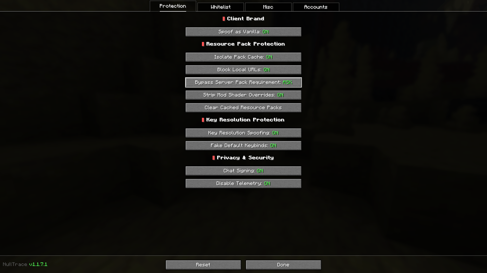
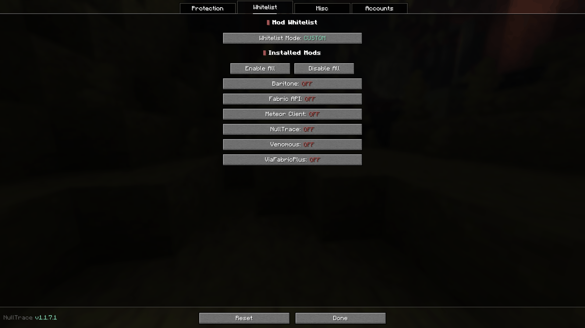
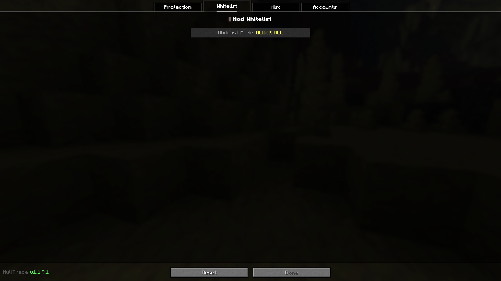
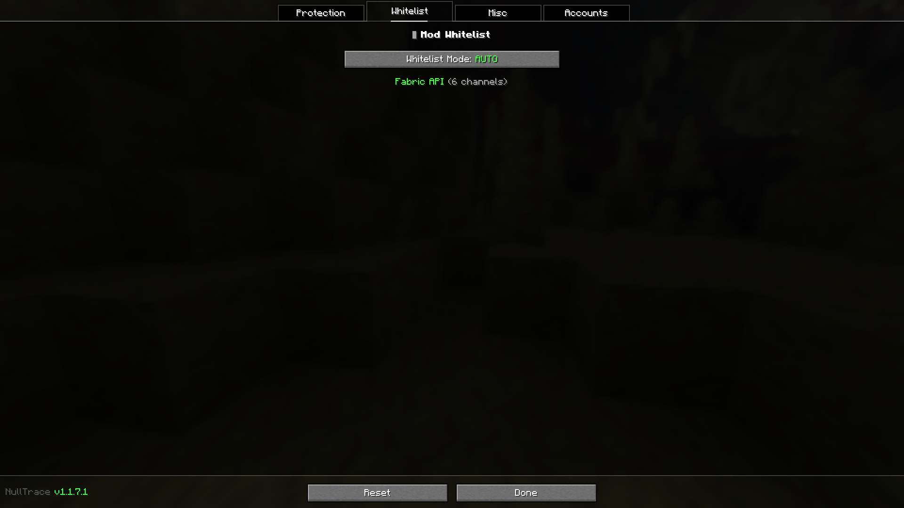
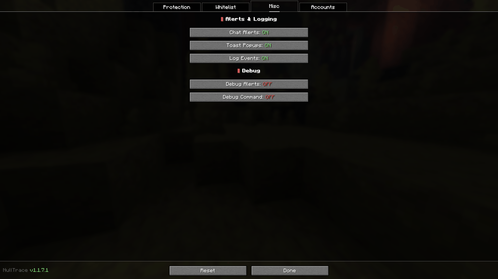
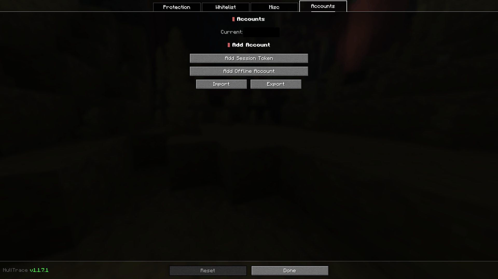

<p align="center">
  
</p>

<h1 align="center">NullTrace</h1>

<p align="center">
  A client-side Minecraft privacy and fingerprinting protection mod for Fabric.
</p>

<p align="center">
  <a href="https://gitlab.com/international-duck-incorporated/NullTrace/-/releases"></a>
  <a href="https://gitlab.com/international-duck-incorporated/NullTrace/blob/main/LICENSE"></a>
</p>

> [!IMPORTANT]
> NullTrace is currently distributed **through GitLab**.
>
> Official downloads are available from the [GitLab Releases](https://gitlab.com/international-duck-incorporated/NullTrace/releases) page and the repository itself.
>
> Any NullTrace JAR found elsewhere should be treated as unofficial.

## About NullTrace

NullTrace is a **fork of [OpSec](https://github.com/aurickk/OpSec)** by [aurickk](https://github.com/aurickk).

The project started from OpSec's client-side privacy and anti-fingerprinting work and has since been developed under the NullTrace name, with its own codebase, package structure, branding, version support, and additional protections.

The purpose of NullTrace is to reduce the amount of client-side information that Minecraft servers can use to identify, fingerprint, or track a modded client.

NullTrace does not make you anonymous. It does not hide your IP address, server-side activity, or every possible fingerprinting technique. It is specifically focused on reducing common client-side fingerprinting and tracking surfaces.

## Features

| Area                     | Protection                                                                                            |
| ------------------------ | ----------------------------------------------------------------------------------------------------- |
| Client brand             | Optionally report a vanilla-like client brand instead of a Fabric brand                               |
| Network channels         | Conditionally filter mod channels registered with the server                                          |
| Known packs              | Filter mod-injected known-pack identifiers                                                            |
| Key resolution           | Protect against translation/keybind probing used to identify installed mods                           |
| Resource packs           | Isolate server-pack caches per account                                                                |
| Resource-pack URLs       | Block requests and redirects targeting local/private addresses                                        |
| Server pack requirements | Allow required packs to remain downloaded while giving the user control over whether they are applied |
| Mod shaders              | Strip server-pack shader overrides targeting installed, non-whitelisted mods                          |
| Chat signing             | Configure message-signing behavior independently of vanilla defaults                                  |
| Telemetry                | Block Minecraft telemetry sent to Mojang                                                              |
| Accounts                 | Switch between stored Minecraft sessions without restarting the client                                |
| Diagnostics              | Optional alerts, toast notifications, logging, and a debug command                                    |

## Protection Model

NullTrace focuses on client-side information that a server can query or influence.

### Client Brand Spoofing

Servers can inspect the client brand reported during connection. With **Spoof as Vanilla** enabled, NullTrace reports a vanilla-like brand and applies the corresponding protection rules for mod-exposed data.

When the whitelist is active in **AUTO** or **CUSTOM** mode, vanilla spoofing is disabled because explicitly allowing mod functionality means those mods may need to identify themselves.

### Channel Spoofing

Fabric mods can register custom network channels. A server can inspect those channels to determine which mods are present.

NullTrace can filter non-whitelisted mod channels before they are exposed to the server.

* **BLOCK ALL** - block all mod content
* **AUTO** - automatically allow mods that register network channels
* **CUSTOM** - manually choose which installed mods are allowed

### Known-Pack Filtering

Some mods expose pack identifiers through Minecraft's known-pack protocol. NullTrace filters mod-injected entries that are not permitted by the current whitelist.

Vanilla entries are retained.

### Key Resolution Protection

A server can send translatable components containing keys such as `key.attack` or mod-specific translation keys. The resolved result can reveal installed mods or configured keybinds.

NullTrace intercepts this resolution path and prevents untrusted server packets from using those keys as a mod fingerprint.

With **Fake Default Keybinds** enabled, vanilla keybinds resolve to their default values instead of the user's actual bindings.

### Resource-Pack Cache Isolation

Server resource packs are normally cached in a shared download location. A server can use pack behavior to associate otherwise separate Minecraft accounts or client instances.

NullTrace can place downloaded server packs into account-specific cache directories.

### Local URL Protection

A malicious resource-pack URL can redirect a Minecraft client toward local or private network addresses.

NullTrace checks resource-pack destinations and blocks requests that resolve to local/private addresses.

### Server Pack Control

Required server resource packs can normally be applied without giving the player a normal toggle in the resource-pack screen.

NullTrace keeps the pack available while allowing the player to control whether its content is actually applied.

Modes:

| Mode          | Behavior                                                                                   |
| ------------- | ------------------------------------------------------------------------------------------ |
| **MANUAL**    | Vanilla behavior on push; the user can later remove or re-enable the pack                  |
| **ASK**       | Required packs are stripped initially and a confirmation overlay asks whether to load them |
| **ALWAYS ON** | Server packs are stripped initially and can only be enabled manually                       |

The server pack language resources remain available so simple translation-key checks cannot rely solely on whether the full visual pack is currently active.

### Mod Shader Override Stripping

A server resource pack can contain files under another mod's asset namespace. For mods such as Meteor Client, that can replace bundled shaders or other client resources.

NullTrace removes shader overrides targeting installed, non-whitelisted mods while leaving the rest of the server pack intact.

Vanilla assets are not stripped.

### Chat Signing

NullTrace provides three signing modes:

| Mode     | Behavior                              |
| -------- | ------------------------------------- |
| **OFF**  | Remove chat signatures                |
| **AUTO** | Sign only when required               |
| **ON**   | Use normal Minecraft signing behavior |

### Telemetry

When enabled, NullTrace blocks Minecraft telemetry requests to Mojang. This does not change normal gameplay networking.

## Configuration

Open the **NullTrace** button in the multiplayer screen or open the configuration through [Mod Menu](https://modrinth.com/mod/modmenu).



Changes made while connected to a server may require reconnecting before every protection is active. Use `/nulltrace audit` to inspect blocked surfaces, allowed surfaces, reasons, and remaining exposure. `/nulltrace profile` shows the current server profile; `/nulltrace profile STRICT` or `/nulltrace profile MAXIMUM_PRIVACY` strengthens protections for that server.

### Protection

| Setting                            | Purpose                                                                    |
| ---------------------------------- | -------------------------------------------------------------------------- |
| **Spoof as Vanilla**               | Enable vanilla-style client identity and strict filtering                  |
| **Isolate Pack Cache**             | Separate server-pack caches by account                                     |
| **Block Local Pack URLs**          | Prevent local/private resource-pack destinations                           |
| **Bypass Server Pack Requirement** | Configure MANUAL, ASK, or ALWAYS ON behavior                               |
| **Strip Mod Shader Overrides**     | Remove server shader overrides for protected mods                          |
| **Clear Cache**                    | Delete cached server resource packs                                        |
| **Key Resolution Spoofing**        | Enable key-resolution protection                                           |
| **Fake Default Keybinds**          | Return default vanilla keybind values                                      |
| **Meteor Fix**                     | Disable Meteor's conflicting key-resolution mixin when Meteor is installed |
| **Signing Mode**                   | Configure chat signing                                                     |
| **Disable Telemetry**              | Block Mojang telemetry                                                     |
| **Normalize Client Information**    | Choose which language, view-distance, chat, and particle values are normalized |
| **Server Privacy Profile**          | Use STANDARD, STRICT, MAXIMUM_PRIVACY, or CUSTOM per server               |

### Whitelist

| Setting            | Purpose                               |
| ------------------ | ------------------------------------- |
| **Whitelist Mode** | BLOCK ALL, AUTO, or CUSTOM            |
| **Installed Mods** | Select individual mods in CUSTOM mode |

Whitelisting is necessary for mods that intentionally communicate with servers. Examples include voice-chat or map-related functionality.



The three whitelist modes:

| BLOCK ALL | AUTO | CUSTOM |
| --------- | ---- | ------ |
|  |  |  |
| Every mod is blocked | Mods that register network channels are allowed automatically | Each installed mod is toggled individually |

### Diagnostics

| Setting            | Purpose                                            |
| ------------------ | -------------------------------------------------- |
| **Show Alerts**    | Show tracking detections in chat                   |
| **Show Toasts**    | Show popup notifications                           |
| **Log Detections** | Write detections to the game log                   |
| **Debug Alerts**   | Report all probed keys, including unchanged values |
| **Debug Command**  | Enable `/nulltrace`                                |



### Accounts

The built-in account manager supports session-based login, account switching, token validation, import/export, and optional offline accounts. Session and refresh tokens are encrypted at rest with AES-GCM in a separate local vault; account exports intentionally omit bearer tokens and require re-authentication on the destination installation.

Treat Minecraft session tokens as credentials. Never paste them into issues, screenshots, Discord messages, or other public locations.



## Commands

`/nulltrace audit` and `/nulltrace profile` are always available so privacy remains inspectable. The detailed registry commands remain behind **Miscellaneous -> Debug Command**.

| Command                              | Description                                                          |
| ------------------------------------ | -------------------------------------------------------------------- |
| `/nulltrace audit`                   | Show blocked/allowed surfaces, reasons, and remaining exposure       |
| `/nulltrace profile`                 | Show the current server profile                                      |
| `/nulltrace profile STRICT`          | Strengthen protections for the current server                        |
| `/nulltrace info`                    | Show tracked mod information                                         |
| `/nulltrace info <mod>`              | Inspect channels, keys, known packs, shaders, and other tracked data |
| `/nulltrace channels`                | List tracked network channels and whitelist status                   |

## Detections

When diagnostics are enabled, common alerts include:

* **Key Resolution Exploit Detected** - a server is probing translation or keybind resolution
* **Resource Pack Fingerprinting Detected** - a suspicious resource-pack destination was detected
* **Local URL Scan Detected** - a resource-pack request targeted a local/private address

## Compatibility

### Current Minecraft Targets

The current `main` branch is maintained for:

| Minecraft    | Covers          | Java | Fabric Loader | Fabric API     |
| ------------ | --------------- | ---- | ------------- | -------------- |
| **1.21.11**  | 1.21.11         | 21   | 0.19.3        | 0.140.2+1.21.11 |
| **26.1**     | 26.1 – 26.1.2   | 25   | 0.19.3        | 0.146.1+26.1.2 |
| **26.2**     | 26.2            | 25   | 0.19.5        | 0.160.0+26.2   |
| **26.3**     | 26.3            | 25   | 0.19.5        | 0.160.5+26.3   |

The `26.1` target is built against 26.1.2 and declares `>=26.1 <26.2`, so a single JAR
covers the whole 26.1 line. Targets older than 1.21.11 are not part of the current
`versions/` tree on `main`.

### Mod Compatibility

NullTrace currently declares conflicts with:

* [ExploitPreventer](https://github.com/NikOverflow/ExploitPreventer)
* Ichor
* LabyMod
* AutismsexDefender

Check the repository metadata and release notes before combining NullTrace with other client modification frameworks.

## Installation

NullTrace is maintained and released on **GitLab**.

### Download

Go to the [GitLab Releases](https://gitlab.com/international-duck-incorporated/NullTrace/releases) page and download the JAR matching your Minecraft version.

The `main` branch currently produces GitLab CI artifacts for Minecraft 1.21.11, 26.1, 26.2 and 26.3. Version tags publish release assets and SHA-256 checksum files.

### Manual Installation

1. Install [Fabric Loader](https://fabricmc.net/use/) for your Minecraft version.
2. Install the matching [Fabric API](https://github.com/FabricMC/fabric-api).
3. Download the matching NullTrace JAR from [GitLab Releases](https://gitlab.com/international-duck-incorporated/NullTrace/releases).
4. Put the JAR in your `.minecraft/mods` directory.
5. Start Minecraft.

[Mod Menu](https://modrinth.com/mod/modmenu) is optional but provides a convenient configuration entry point.

## Building

NullTrace uses [Fabric Loom](https://github.com/FabricMC/fabric-loom) and [Stonecutter](https://stonecutter.kikugie.dev/) for multi-version builds.

### Requirements

* Java 25 for the 26.1, 26.2 and 26.3 targets; Java 21 or newer for 1.21.11
  (a Java 25 JDK can build every target, since 1.21.11 is compiled with `--release 21`)
* Git
* No system Gradle installation is required; the repository includes the Gradle wrapper

### Clone

```bash
git clone https://gitlab.com/international-duck-incorporated/NullTrace.git
cd NullTrace
```

### Build A Single Minecraft Version

Replace `<version>` with `1.21.11`, `26.1`, `26.2` or `26.3`.

Linux/macOS:

```bash
./gradlew :<version>:build
```

Windows:

```powershell
.\gradlew.bat :<version>:build
```

For example, `./gradlew :26.3:build`.

### Build Every Version

Linux/macOS:

```bash
./gradlew buildAll
```

Windows:

```powershell
.\gradlew.bat buildAll
```

Generated JARs are written below:

```text
versions/<minecraft-version>/build/libs/
```

## Development

NullTrace uses a shared source tree with version-specific Stonecutter projects under `versions/`.

The current repository layout is broadly:

```text
NullTrace/
├── .gitlab-ci.yml           # GitLab build, test, security, and release pipeline
├── docs/assets/             # Project artwork
│   └── screenshots/         # In-game UI screenshots used by this README
├── src/main/                # Shared/common code
├── src/client/              # Client-only code and mixins
├── versions/
│   ├── 1.21.11/
│   ├── 26.1/
│   ├── 26.2/
│   └── 26.3/
├── build.gradle
├── gradle.properties
├── stonecutter.gradle
└── settings.gradle.kts
```

When changing Minecraft-specific code, test the affected version target rather than assuming the mappings and client internals are identical.

## Issues and Contributions

Use the [issue tracker](https://gitlab.com/international-duck-incorporated/NullTrace/issues) for bug reports, reproducible compatibility problems, and feature requests.

Pull requests should:

* Keep version-specific changes isolated where possible.
* Avoid introducing server-side dependencies for a client-only feature.
* Preserve the existing GPL-3.0-only licensing.
* Include testing information for the Minecraft version(s) affected.

## Credits

NullTrace is a fork of [OpSec](https://github.com/aurickk/OpSec) by [aurickk](https://github.com/aurickk).

The project retains attribution to the original project while continuing development independently under the NullTrace name.

Additional implementations and research are based on or informed by:

* [ExploitPreventer](https://github.com/NikOverflow/ExploitPreventer) - local URL blocking and key-resolution protection concepts
* [LiquidBounce](https://github.com/CCBlueX/LiquidBounce/blob/nextgen/src/main/java/net/ccbluex/liquidbounce/injection/mixins/minecraft/util/MixinDownloadQueue.java) - resource-pack cache isolation
* [Meteor Client](https://github.com/MeteorDevelopment/meteor-client) - account/session handling and compatibility fixes
* [No Chat Reports](https://modrinth.com/mod/no-chat-reports) - chat-signing and telemetry-related functionality
* [No Prying Eyes](https://github.com/Daxanius/NoPryingEyes) - secure-chat enforcement research
* [MixinSquared](https://github.com/Bawnorton/MixinSquared) - mixin cancellation used by the Meteor compatibility fix
* [Fabric API](https://github.com/FabricMC/fabric-api) - Fabric client and networking integration
* [Stonecutter](https://stonecutter.kikugie.dev/) - multi-version project management

## License

NullTrace is licensed under the [GNU General Public License v3.0](https://www.gnu.org/licenses/gpl-3.0.html).

See [LICENSE](LICENSE) for the complete license text.

